# Neural Correlates of Word onset response in human iEEG - draft 
Working notes. Figures refresh with `zsh paper/sync_figures.sh` after replotting.
Values from the 2026-10-06/08 runs (1009 sessions); **(verify)** = check before writing.

## Literature review (long list, to be cut down)
Full citations and DOIs: `git show 0d2ee1b:paper/literature.md` (file removed 2026-10-20). **(M)** = also a Methods citation, move if needed.

### 1. What is known about the word-onset response in this paradigm
Most intracranial EEG (iEEG) studies of free recall contrast words that are later recalled with words that are forgotten (the subsequent memory effect, SME), or study the retrieval period (Sederberg et al. 2003, 2007; Burke et al. 2013; Long et al. 2014; Solomon et al. 2017; Rubinstein et al. 2023). Because both conditions contain a word, this contrast measures how responses differ with later memory, but cancels out the response to the word itself. Only a few studies have examined the word-onset response directly. Long et al. (2020, preprint) identified electrodes with a high-gamma (HG) response to words in 151 patients performing the same task and used representational similarity analysis to time when word features are represented. Burke, Long et al. (2014) found that the high-frequency activity (HFA) SME appears first in posterior regions and later in anterior ones. Kucewicz et al. (2019) showed that HG after word onset moves from visual cortex to the medial temporal lobe (MTL) and then to prefrontal cortex, and Marks et al. (2021) found that theta, alpha/beta and gamma activity each spread across regions on their own timelines during word encoding.

### 2. High gamma as local activation, alpha/beta decrease as release from inhibition
Broadband HG (70-150 Hz) is widely used as a measure of local population spiking (Manning et al. 2009; Ray & Maunsell 2011; Lachaux et al. 2012), although it may also reflect synaptic input (Leszczyński et al. 2020), and is better described as a broadband signal than as an oscillation (Burke, Ramayya & Kahana 2015). At stimulus onset, alpha and beta power decrease, a phenomenon known as event-related desynchronization (Pfurtscheller & Aranibar 1977; Pfurtscheller & Lopes da Silva 1999; Klimesch 1999, 2012; Klimesch et al. 2007). This decrease is thought to release cortex from alpha-mediated inhibition (Jensen & Mazaheri 2010; Haegens et al. 2011). An alpha/beta decrease together with a gamma increase is the typical cortical activation response, first described in the sensorimotor cortex with electrocorticography (Crone et al. 1998a, b) and observed in the visual cortex in iEEG (Lachaux et al. 2005; Tallon-Baudry et al. 2005). Vidal et al. (2010) found this pattern for pseudowords and consonant strings, with less than 10% spatial overlap between the electrodes selective in each band. Visual stimuli can evoke both narrowband gamma oscillations and broadband gamma (Hermes et al. 2015; Bartoli et al. 2019). Occipital alpha is strong and reactive to visual input (Geller et al. 2014; Frauscher et al. 2018), and propagates from higher-order to lower-order visual cortex (Halgren M et al. 2019). Gamma activity in occipitotemporal cortex also carries information about the identity of individual letters and words (Jacobs & Kahana 2009). Not every region is engaged by a stimulus. Alpha increases in task-irrelevant cortex are thought to actively inhibit it (Jensen & Mazaheri 2010), and HG often decreases during tasks, particularly in default-mode regions (Ossandón et al. 2011; Kucyi et al. 2020; Das, de los Angeles & Menon 2022). Frontal low-frequency increases and beta decreases can, however, also signal engagement: frontal theta increases accompany cognitive control (Cavanagh & Frank 2014; Raghavachari et al. 2001), and beta decreases have been linked to a change in the current cognitive set (Engel & Fries 2010; Spitzer & Haegens 2017).

### 3. The spectral signature of encoding (alpha, gamma, spectral tilt)
Successful encoding (encoding contrast: recalled vs not recalled) is marked by a decrease in low-frequency power and an increase in HFA (Sederberg et al. 2003, 2007; Burke et al. 2013; Long et al. 2014; Greenberg et al. 2015; Kucewicz et al. 2017, 2018; Marks et al. 2021; Katerman et al. 2022; Rubinstein et al. 2023). The information-via-desynchronization hypothesis proposes that alpha/beta power decreases allow neural populations to represent richer information, so that larger decreases accompany deeper encoding (Hanslmayr et al. 2009, 2011, 2012; Hanslmayr & Staudigl 2014). Whether these effects are band-specific or reflect a single broadband tilt of the spectrum, with low frequencies falling and high frequencies rising, remains debated (Podvalny et al. 2015; Burke et al. 2015; Rudoler et al. 2023; Fellner et al. 2019; Broitman & Kahana 2026, preprint); the aperiodic background changes at stimulus onset (Gyurkovics et al. 2022) and can be separated from oscillatory peaks (Donoghue et al. 2020) **(M)**. Tilt also appears beyond memory, during arithmetic (Randazzo et al. 2019, preprint), where it predicts slower responses, mainly in frontal regions (DeHaan et al. 2025, preprint).

### 4. Timing of visual word processing (latency figure)
Reading a word unfolds in stages: visual features are extracted within about 100 ms (Thorpe et al. 1996; Schmolesky et al. 1998), the letter string is recognised as a word at about 200 ms (Cohen et al. 2000), its sound is activated automatically (Van Orden 1987), and its meaning is integrated with context at about 400 ms (Kutas & Hillyard 1980). Visual words are processed along a ventral stream hierarchy, from posterior responses to letter strings to more anterior responses sensitive to lexical status (Nobre et al. 1994; Allison et al. 1994, 1999; Lerner et al. 2001; Grainger & Holcomb 2009; Carreiras et al. 2014; Grill-Spector & Weiner 2014). One account gives a central role to a visual word form area (VWFA) in left fusiform cortex (Cohen et al. 2000; Dehaene & Cohen 2011), while an interactive account emphasises top-down feedback to ventral occipitotemporal cortex (Price & Devlin 2011). iEEG studies report HG latencies close to ours. Word-selective electrodes respond at 153 ms in left ventral temporal cortex and 194 ms in left lateral occipital cortex (Kadipasaoglu et al. 2016), compared with 157 ms in fusiform here. Gamma activity begins at 150 ms in basal temporal cortex, reaches the VWFA at 200 ms, and reaches superior temporal and Broca's areas after 400 ms (Mainy et al. 2008). Word-length effects appear at the occipital pole at 75 ms and move anteriorly, word-frequency effects appear at 150 ms in mid-fusiform cortex, and word selectivity feeds back to posterior regions at 250–500 ms (Woolnough et al. 2021). Letter-selective responses precede word-selective ones by about 60 ms (Thesen et al. 2012), ventral temporal signals begin at about 100 ms (Jacques et al. 2016), and fusiform responses consist of a sharp early peak followed by sustained activity (Ghuman et al. 2014). Scene-selective parahippocampal cortex responds from about 80 ms (Bastin et al. 2013). Further iEEG work has characterised reading responses in left mid-fusiform and inferotemporal cortex (Gaillard et al. 2006; Hamamé et al. 2013; Hirshorn et al. 2016; Lochy et al. 2018).

Beyond the ventral stream, MEG shows semantic responses proceeding from Wernicke's area to anterior temporal cortex, Broca's area, and finally orbital/frontopolar cortex at about 370 ms (Halgren et al. 2002), the same order as ours with orbitofrontal cortex last. Activity converges in anterior temporal and inferior prefrontal cortex at about 400 ms (Marinkovic et al. 2003), and Broca's area shows lexical, grammatical and phonological stages at about 200, 320 and 450 ms (Sahin et al. 2009). Other work confirms that temporal cortex precedes frontal cortex in reading and naming (Chan et al. 2011; Flinker et al. 2015; Forseth et al. 2018; Woolnough et al. 2022, 2023). The contrast between sharp early and broad late peaks may reflect feedforward input at 120–170 ms followed by feedback after about 550 ms, as seen in laminar recordings (Halgren et al. 2006). Hippocampal responses come last in face recognition, at about 480 ms (Barbeau et al. 2008), and anterior medial temporal cortex shows a late N400 to words (McCarthy et al. 1995). MTL single neurons respond in the same order as our regions but later: parahippocampal at 271 ms, hippocampus at 394 ms and amygdala at 397 ms (Mormann et al. 2008; see also Kreiman et al. 2000; Quiroga et al. 2005).

### 5. Synchrony: alpha phase coupling vs high-gamma envelope coupling (methods and findings, may move to Methods)
Alpha phase synchrony is thought to coordinate distant regions actively rather than reflect idling (Palva & Palva 2007, 2011; Doesburg et al. 2009; Palva et al. 2010; Bonnefond et al. 2017), and occipital alpha gates the flow of information to object-selective cortex (Zumer et al. 2014). In visual cortex, alpha/beta rhythms carry feedback and gamma carries feedforward signals (van Kerkoerle et al. 2014; Bastos et al. 2015; Michalareas et al. 2016; Mejias et al. 2016), consistent with communication through coherence (Fries 2005, 2015); this offers one reading of the occipital alpha hubs at 0–400 ms. Alpha power can fall while alpha synchrony between regions rises (Hanslmayr et al. 2016), matching our combination of decreased alpha power with increased ciPLV. Phase synchrony supports memory in iEEG (Fell et al. 2001; Watrous et al. 2013; Fell & Axmacher 2011; Solomon et al. 2017, 2019), including theta hubs during retrieval in the same dataset (Rao et al. 2025), and long-range synchrony during word encoding predicts memory in scalp EEG (Weiss & Rappelsberger 2000). Conscious visual perception is likewise accompanied by long-range synchrony (Rodriguez et al. 1999; Fisch et al. 2009; Gaillard et al. 2009). In contrast, HFA appears to be local and asynchronous: regions with gamma increases during successful encoding (encoding contrast) lose global synchrony (Burke et al. 2013), HFA desynchronizes during successful encoding and retrieval (Solomon et al. 2017), and once evoked activity is removed, tasks tend to reduce correlations between areas (Ito et al. 2020). These findings are consistent with our null HG AEC-c result. Other studies, however, report HG envelope coupling that depends on the task (Vidal et al. 2012; Foster et al. 2015) and widespread co-bursting of high-frequency oscillations during word encoding (Prathapagiri et al. 2026). Directed connectivity has also been studied in these data (Das & Menon 2021–2024).

Metric choice matters for these comparisons. ciPLV removes zero-lag coupling caused by volume conduction (Lachaux et al. 1999; Nolte et al. 2004; Bruña et al. 2018), as do related phase metrics (Vinck et al. 2010, 2011), and orthogonalized amplitude envelope correlation removes zero-lag leakage from envelope coupling (Bruns et al. 2000; Brookes et al. 2012; Hipp et al. 2012; Colclough et al. 2015). Phase and amplitude coupling are distinct modes of interaction (Siegel et al. 2012; Engel et al. 2013; Siems & Siegel 2020). Leakage-robust metrics can still produce spurious "ghost" edges next to true ones (Haufe et al. 2013; Bastos & Schoffelen 2016; Palva et al. 2018), which is relevant to the strongest-edge networks. Orthogonalized envelope correlation is more reliable across sessions than lag-based phase metrics (Colclough et al. 2016) **(M)**. Finally, connectivity in iEEG depends strongly on distance between contacts (Mercier et al. 2017; Betzel et al. 2019) **(M)**.

### 7. Anticipation (jittered blank before the word)
Reaction times and neural responses depend on how long the participant waits for a stimulus and on the changing probability that it will appear (the hazard rate; Niemi & Näätänen 1981; Coull & Nobre 1998, 2008; Nobre et al. 2007; Nobre & van Ede 2018), and single neurons encode the hazard rate (Ghose & Maunsell 2002; Janssen & Shadlen 2005). Temporally expected events evoke larger visual responses: in monkey V1, gamma increases and alpha decreases when a stimulus is expected (Lima et al. 2011), and expectation speeds and enhances visual processing in humans (Doherty et al. 2005; Vangkilde et al. 2012). Human recordings show that cortical rhythms entrain to the expected timing of events (Lakatos et al. 2008; Stefanics et al. 2010; Besle et al. 2011). Pre-stimulus alpha follows temporal expectation (Rohenkohl & Nobre 2011; Cravo et al. 2011, 2013) and biases perception (Thut et al. 2006; van Dijk et al. 2008; Busch et al. 2009; Mathewson et al. 2009; Iemi et al. 2017; Samaha et al. 2020). We found no iEEG study of how a longer inter-stimulus interval (ISI) affects responses during verbal encoding.

### 8. Does the word-onset response predict recall?
Spectral features recorded while a word is studied predict whether it will be recalled (encoding contrast; L2-regularised logistic regression; Ezzyat et al. 2017, 2018) **(M)**, although these classifiers partly track general fluctuations in brain state rather than encoding of the item (Weidemann & Kahana 2021). In the same contrast, HFA predicting later recall appears first in visual, fusiform and medial temporal regions (about 0–500 ms) and later in left inferior frontal, posterior parietal and ventrolateral temporal cortex (about 400–900 ms; Burke, Long et al. 2014). Activity before a stimulus can also predict memory: pre-stimulus hippocampal theta predicts later recognition but not recall (Merkow et al. 2014), pre-stimulus MTL and cortical low-frequency activity predict encoding success in iEEG (Fell et al. 2011; Haque et al. 2015), and similar effects appear in fMRI, MEG and scalp EEG (Otten et al. 2006; Guderian et al. 2009; Addante et al. 2011).

### 9. Gap this paper fills
To our knowledge, this is the first whole-brain map of the response to word onset itself, contrasting each word with the blank screen before it, rather than contrasting recalled with forgotten words. With 362 patients, it gives a complete set of HG onset latencies across all regions, extending the existing literature. It also tests phase (alpha ciPLV) and envelope (HG AEC-c) coupling in the same data. Other open free-recall iEEG datasets could be used to replicate these results (Cimbalnik et al. 2025).

## Methods

### Data and cohort
- OpenNeuro BIDS releases of the RAM / Penn free-recall data (FR1, catFR1) and pyFR, bipolar montage. OpenNeuro ds004789 (FR1), ds004809 (catFR1), ds004865 (pyFR). 
- 362 subjects, 1009 sessions: FR1 232 subj / 466 sess, catFR1 212 / 465, pyFR 38 / 78.
- Bipolar channels whose contacts are > 20 mm apart, and flat channels are dropped.
- Exclusions: missing / < 499 Hz sampling rate, denylist / manual, mains-harmonic peak > 5× its neighbours at a non-notched frequency (9 sessions, all 100 Hz peaks at 60 Hz sites).
- Contrast: **word on** (0–600 ms after word onset) vs **word off** (−700 to −100 ms, the blank screen before the same word). Words on screen 1600 s; blank between words ~750-1250 ms.

### Preprocessing
- Word-off and word-on clips loaded separately per word, each with 500 ms of real data buffer on both sides.
- Resampled to 500 Hz, notch 60 Hz + 120 Hz harmonic (4th-order Butterworth, ±2 Hz); buffer cropped before every estimate. [cite: Widmann et al. 2015; de Cheveigné & Nelken 2019; Gramfort et al. 2013; Virtanen et al. 2020]
- Why 500 ms buffer: resampling (FFT) and notching each short clip ring at its edges for > 50 ms; the ringing is simultaneous across channels and biased the amplitude-correlation measure (AEC-c). No effect on multitaper alpha (Supplement)

### Electrode localization
- Bipolar pairs labelled by lab localization default (depth: volumetric; grid/strip: surface). [cite: Desikan et al. 2006; Fischl et al. 2002, 2004; Avants et al. 2008; Wang et al. 2013; Yushkevich et al. 2015; Azarion et al. 2014 (check); bipolar: Mercier et al. 2022; Li et al. 2018]
- 12 Burke ROIs: frontal, temporal, parietal, occipital, limbic, hippocampus × hemisphere; sub regions = anatomical labels within them. [cite: Burke et al. 2013]

### Power
- Alpha (8–13 Hz) and 5–100 Hz spectrum: multitaper, 2 Hz bandwidth, 600 ms windows; spectrum in 10 log-spaced bins (48–52 / 58–62 Hz excluded). [cite: Thomson 1982; Slepian 1978; Percival & Walden 1993; Prerau et al. 2017]
- High gamma (70–150 Hz): Hilbert in 8 × 10 Hz sub-bands, each divided by its word-off mean, averaged (broadband, every frequency weighted equally). [cite: Edwards et al. 2009 (check); Bruns 2004; Manning et al. 2009; Ray & Maunsell 2011]
- Per electrode: Cohen's d of per-trial power, word on vs word off. [cite: Cohen 1988; Lakens 2013]

### High-gamma latency
- Responsive electrodes: per-trial high-gamma power word on > word off (one-tailed Welch t test, BH-FDR within session): 5004 of 122,339 electrode-sessions, 293 subjects. [cite: Welch 1947; Benjamini & Hochberg 1995; selection-then-measure: Kriegeskorte et al. 2009]
- Latency: trial-mean envelope minus word-off mean, 30 ms smoothing, first time it reaches half its peak within 0–800 ms (half-maximum). [cite: Kiesel et al. 2008; Liesefeld 2018; filter smearing: VanRullen 2011]
- Subject median per region → mean ± SEM across subjects; 12 ROIs and subregions (hemispheres pooled).

### Synchrony
- Alpha: ciPLV (MNE `spectral_connectivity_epochs`, multitaper, 2 Hz bandwidth). [cite: Bruña et al. 2018; Nolte et al. 2004; MNE-Connectivity (Zenodo)]
- High gamma: AEC-c (70–110 Hz band-pass + Hilbert, `envelope_correlation`, pairwise orthogonalized, signed, mean over trials); 70–110 Hz so the envelope stays below the band (Bedrosian). [cite: Hipp et al. 2012; Bedrosian 1963]
- Pairs sharing a contact excluded. [cite: Mercier et al. 2017] Per electrode: mean on − off change over all partners (Rao et al. 2025).

### Time-resolved network (epochs)
- 9 overlapping 200 ms epochs every 100 ms, 0–1000 ms (stops before the word's offset response at 1600 ms), each minus the mean of three 200 ms word-off epochs.
- Region pairs with ≥ 100 subjects. Hub (Rao): a region's mean change over its connections; t across subjects; two-stage FDR (Benjamini–Krieger–Yekutieli) over region × epoch. [cite: Benjamini et al. 2006; Rubinov & Sporns 2010]
- Edges: each significant hub's 5 strongest connections (|mean change|), either sign; width ∝ |t| (Solomon et al. 2017 style).

### Mixed-effects models (R lme4 / emmeans; `mixed_models.R`)
- Latency: latency_ms ~ lobe + (1|sub) + (1|sub:lobe) + (1|sub:region), one row per responsive electrode; all 15 lobe pairs, Holm.
- Power: cohens_d ~ lobe × band + (1 + band|sub) + (1|sub:lobe) + (1|sub:lobe:band) + (1|sub:region) + (1|sub:label); lobe × band interaction contrast per lobe pair, Holm.

### Anticipation
- Responsive electrodes (as latency); trials split at the session's median blank length; peak (0–800 ms) of the trial-mean high-gamma response after long minus short waits; subject mean per ROI, one-sample t, BH-FDR over ROIs.

### Recall prediction (encoding contrast: recalled vs not recalled)
- High-gamma response (as latency) in 100 ms windows, 0–1000 ms, z-scored within session; per subject × lobe (≥ 5 electrodes) × window: L2 logistic regression (C = 7.2e-4, Ezzyat et al. 2017), balanced class weights, leave-one-session-out (single-session subjects: leave-one-list-out); AUC of pooled held-out predictions.
- Across subjects: one-sided t of AUC > 0.5, BH-FDR over lobe × window; permutation chance (~0.49) reported only.

### Reliability
- Subjects' sessions split at random into two halves (≥ 2 sessions per half; riley-thesis rules); per half, d (power) or node strength (synchrony) averaged per anatomical region; test-retest = Pearson r across the subject's regions between halves.

### Statistics
- Sessions averaged per electrode, electrodes per subject × region (≥ 1 electrode); one-sample t vs 0 across subjects; BH-FDR within each figure / band; ≥ 30 subjects per region. [cite: Holmes & Friston 1998; Benjamini & Hochberg 1995; Seabold & Perktold 2010]

### Validation (simulations, real montages and events, signal replaced)
- Power: planted high-gamma gain recovered (≈ identity without noise), 0 elsewhere.
- ciPLV: lagged alpha coupling recovered monotonically; 0 for null, zero-lag leak, envelope plant; planted 400–800 ms coupling found only at 400–800 ms.
- AEC-c: planted shared envelope recovered (0.16 → 0.39 → 0.59 with depth); non-target pairs 0; zero-lag leak rejected; timing correct.
- Spectrum: 60 Hz notch ringing at clip edges (resolved with the 500 ms buffer; 64 Hz bin now unbiased).

## Results

### 1. Power changes at word onset
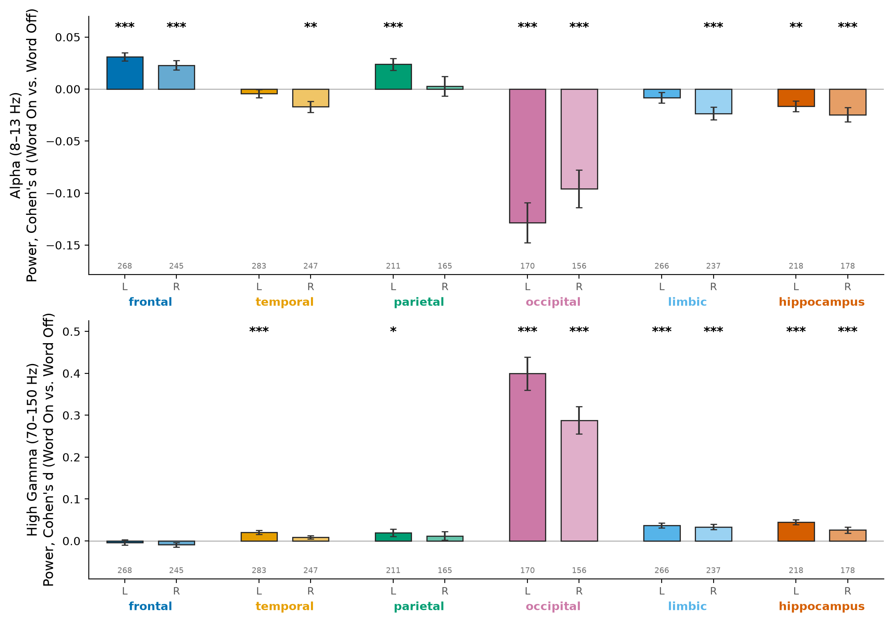
- Alpha: decrease in occipital (L −0.14, R −0.11 d), smaller decreases in limbic, hippocampus, R temporal; increase in frontal (L +0.031, R +0.024) and L parietal (+0.020).
- High gamma: large increase in occipital (L +0.41, R +0.33 d); smaller increases in limbic (+0.04), hippocampus (+0.04), L temporal (+0.02); slight decrease R frontal (−0.011).

#### Spectral profile
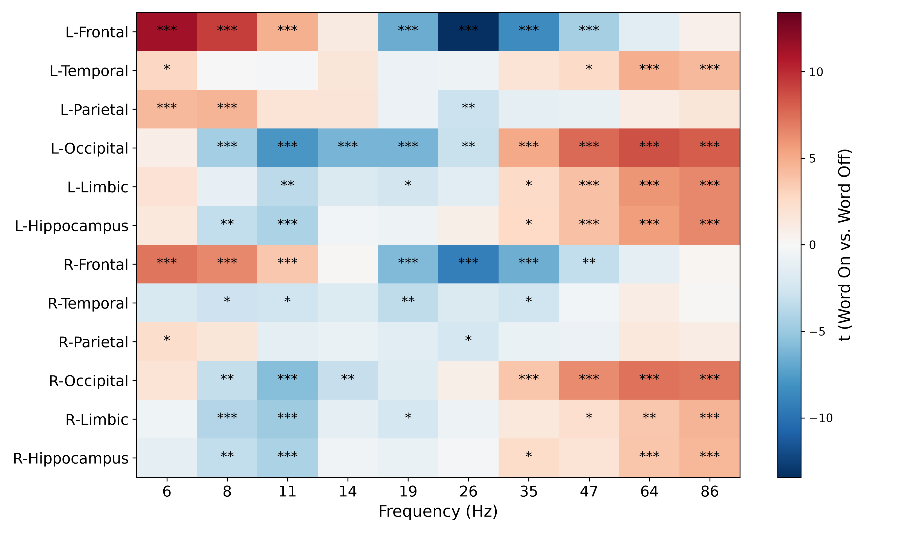
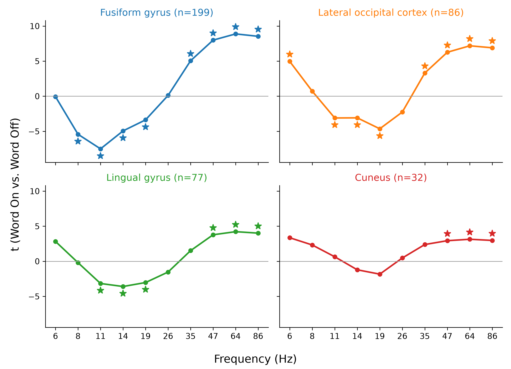
- Frontal: theta/low-alpha increase (t up to 11) with beta decrease (t to −13.5).
- Occipital: alpha–beta decrease (10.6 Hz t ≈ −8), broadband increase ≥ 35 Hz (t up to 8.6).
- Limbic / hippocampus: mild alpha decrease, gamma increase.
- Occipital subregions (hemispheres pooled; the 4 with most subjects): fusiform (199), lateral occipital (86), lingual (77), cuneus (32). All: alpha/beta decrease and gamma increase (≥35–47 Hz); fusiform strongest (t ≈ −7.5 at 11 Hz, +8.9 at 64 Hz); lateral occipital also a 6 Hz increase; cuneus weakest (gamma only). TFCE, family-wise p < .05. [cite: Smith & Nichols 2009; Mensen & Khatami 2013; Nichols & Holmes 2002]
#### Mixed model (lobe × band)
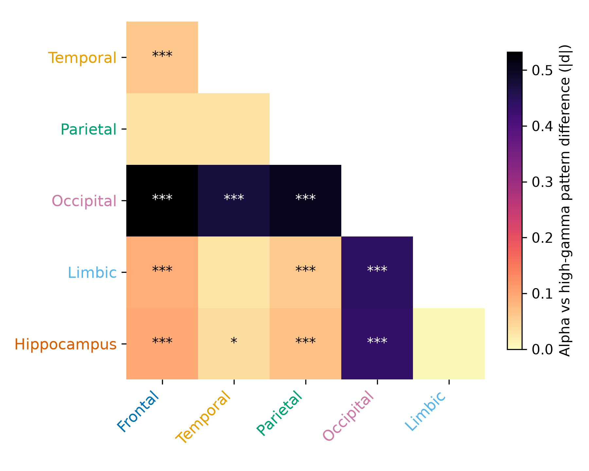
- Does the alpha-vs-high-gamma pattern differ between lobes (lobe × band interaction)? 11 of 15 pairs differ (Holm).
- Occipital differs from every other lobe (|d| 0.43–0.53); frontal from temporal, limbic and hippocampus (0.06–0.10); parietal from limbic and hippocampus; hippocampus from temporal.
- Not different: frontal vs parietal, parietal vs temporal, limbic vs temporal (p = .07), hippocampus vs limbic.
- Maybe add - neocortical and cortical alpha/beta decreases alongside hippocampal theta/gamma increases (Hanslmayr et al. (2016); Staresina et al. 2016; Griffiths et al. 2019, 2021).

### 2. Order of activation
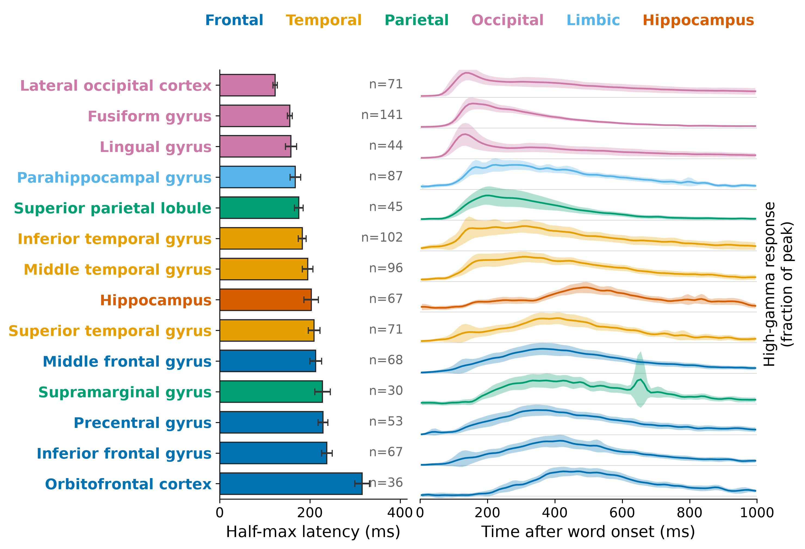
- Posterior → anterior: R occipital 128 ms, L occipital 157 → limbic, R temporal (~164–169) → R hippocampus, R parietal (~175–178) → L temporal 199, L hippocampus 207, R frontal 216 → L parietal 235, L frontal 259 ms.
- Subregions: lateral occipital 122 → lingual 150, fusiform 157 → parahippocampal 167, amygdala 170, insula 174 → superior parietal 188, temporal gyri ~189–194, hippocampus 192 → supramarginal 214, frontal gyri 215–237 → orbitofrontal 300 ms.
- Early regions: sharp peak ~150 ms; hippocampus / insula / frontal: broad peaks ~350–550 ms.

#### Mixed model (latency per lobe)
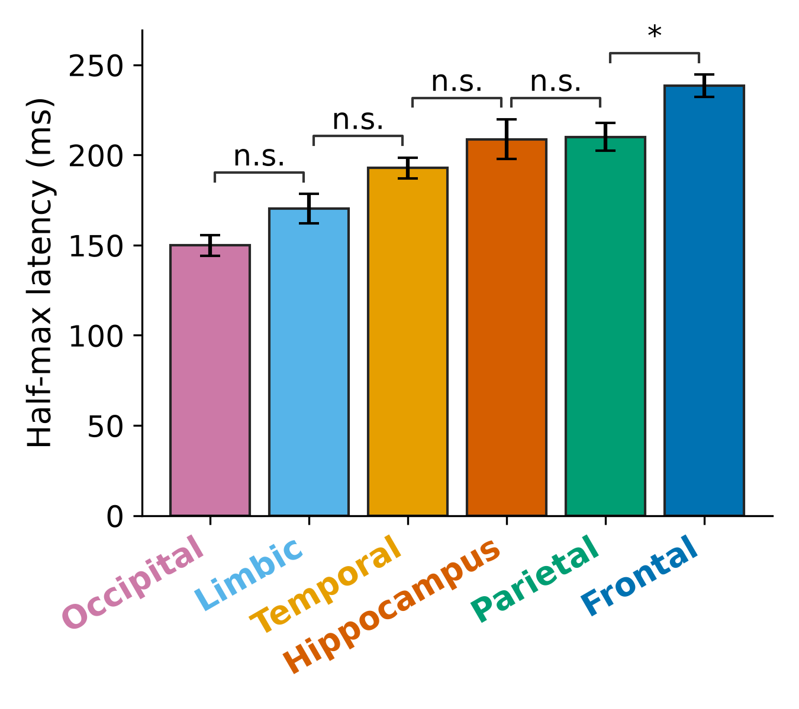
- Estimated latency: occipital 148 → limbic 171 → temporal 190 → hippocampus 199 → parietal 215 → frontal 241 ms.
- Neighbouring steps (brackets): occipital < limbic (p = .045) and parietal < frontal (p = .045); limbic–temporal (p = .08), temporal–hippocampus and hippocampus–parietal (p = .39) not separable.
- All 15 pairs (CSV): 12 differ (Holm p < .05); posterior → anterior holds at the lobe level, not every step.

### 3. Synchrony
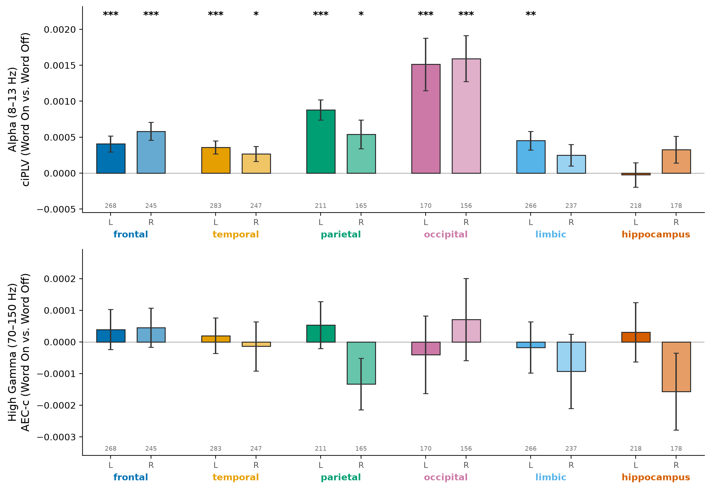
- Alpha ciPLV increases in 10 / 12 ROIs, about twice as much in occipital (~0.0016) as elsewhere (~0.0003–0.0008).
- High-gamma AEC-c: no significant change in any ROI.

#### Time-resolved network
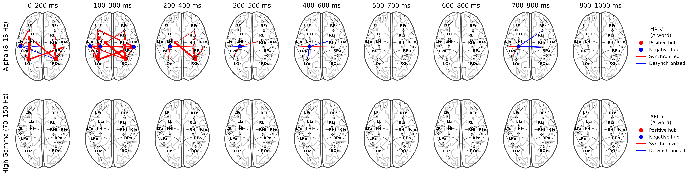
- Alpha: 38 hub × epoch cells; occipital hubs 0–400 ms; parietal from 100 ms; frontal, temporal, limbic mainly 400–1000 ms; fine regions (9 cells): L fusiform 0–400 ms → L inferior/middle temporal 500–1000 ms, L orbitofrontal 400–600 ms.
- High gamma: 3 hubs (bilateral occipital 0–200 ms, L limbic 200–400 ms); no fine-region hubs; no late desynchronization.

### 4. Anticipation (blank length before the word)
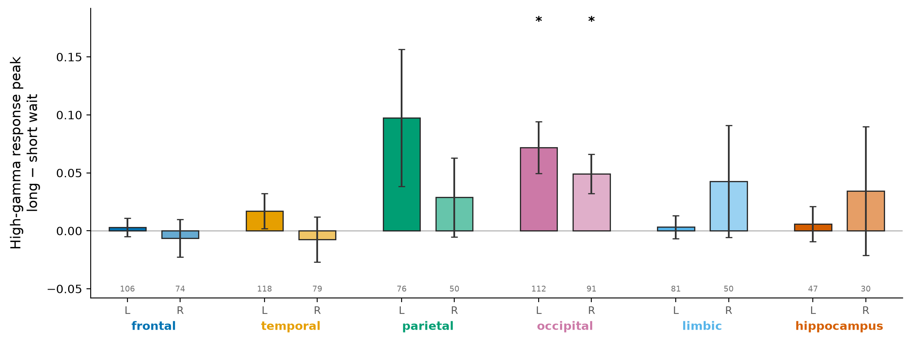
- Occipital high-gamma peak larger after long than short waits (L +0.078, R +0.053; q = .024 both); no other ROI significant.
- Consistent with temporal expectation boosting visual responses (Lima et al. 2011, monkey V1; Nobre & van Ede 2018), but a shorter blank also leaves less time for the previous word's offset response to decay (baseline).

### 5. Recall prediction over the response (encoding contrast)
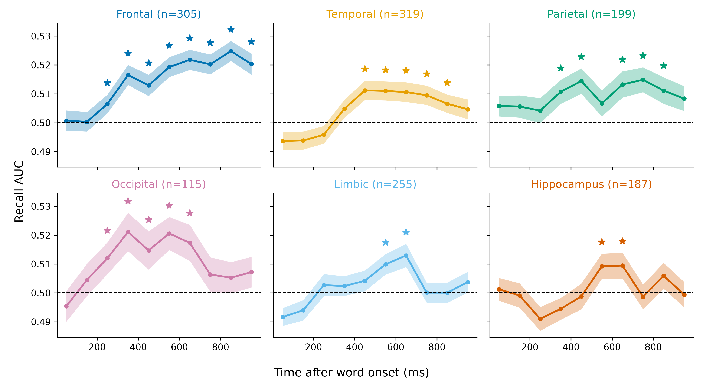
- No lobe predicts recall before 200–300 ms (first significant window: frontal and occipital 200–300 ms).
- Frontal: sustained 200–1000 ms, highest at 800–900 ms (AUC 0.525).
- Occipital: 200–700 ms only (peak 0.521 at 300–400 ms); temporal 400–900 ms; parietal 300–900 ms (patchy); limbic and hippocampus 500–700 ms.
- AUCs are low (≤ 0.525) because each classifier uses one lobe's high gamma in one window. Same direction as Burke, Long et al. 2014 (encoding contrast: early posterior, late frontal HFA SME).

### 6. Reliability across sessions
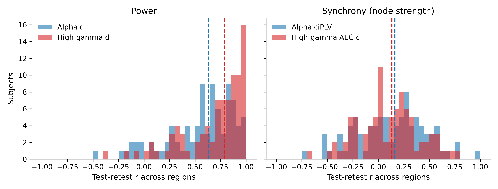
- 87 subjects with ≥ 2 sessions per half. Power maps repeat: median r 0.63 (alpha), 0.79 (high gamma). Synchrony maps much less: 0.16 (alpha ciPLV), 0.13 (high-gamma AEC-c). **(verify: CSV from 2026-10-14, script changed since)**

## Supplementary
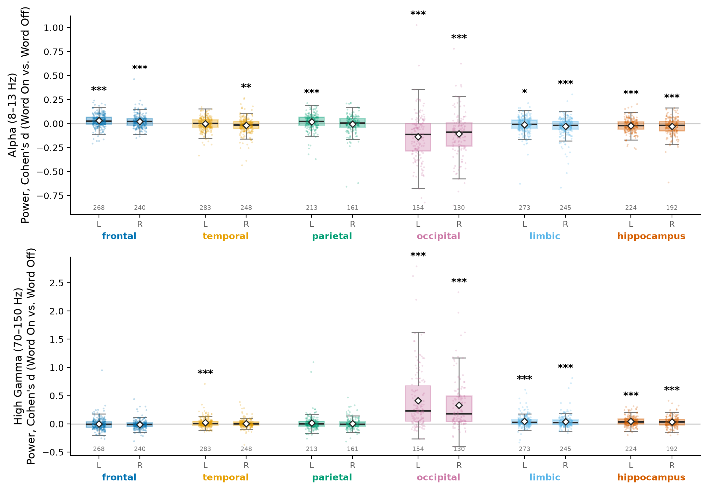
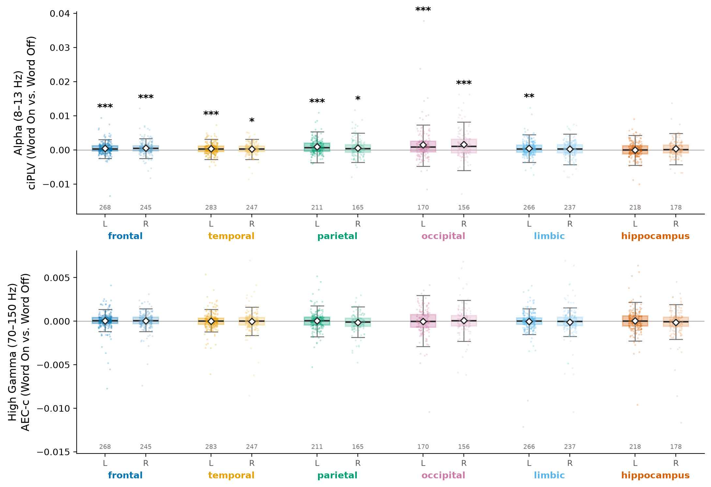

## Limitations / discussion
- Word-off baseline starts ~80-410 ms after the previous word's offset: possible offset response / anticipation in the baseline; the blank-length split (Results 4) cannot separate the two.
- No ERP subtraction: evoked activity contributes to power and synchrony, especially occipital.
- Neighbour-transferred labels (~11% / 21% disagreement in LOSO).
- High-gamma phase metrics avoided (broadband HFA has no meaningful phase); AEC-c null is consistent with high gamma being local and asynchronous (Solomon et al. 2017, 2019).
- Multiple comparisons corrected within figures, not across.

### add somewhere here -  Stimulus-locked activity in connectivity 
- Subtracting the average ERP leaves a residual because amplitude and latency vary across trials: Truccolo et al. 2002; Wang, Chen & Ding 2008; Knuth et al. 2006.
- Evoked and induced activity can't be cleanly separated: David et al. 2006; Shah et al. 2004. This supports the PI's position.
- Is alpha phase reset? For: Makeig et al. 2002; Hanslmayr et al. 2007. Against: Mazaheri & Jensen 2006. Hard to tell apart: Yeung et al. 2004; Sauseng et al. 2007.
- Task-evoked activity inflates connectivity: Cole et al. 2019; van Diepen & Mazaheri 2018; Kramer et al. 2008 (sharp transients).
- Alternatives to subtraction:
  - Matched condition contrast with a label-shuffle null: Solomon et al. 2017; Maris et al. 2007.
  - Trial-shuffled (shift-predictor) surrogates: Perkel et al. 1967; Aertsen et al. 1989; Brody 1999.
  - Connectivity aligned to internal HFA peaks: Dede et al. 2025.
  - Phase consistency on the same data: Colyer & Kahana 2025.

## Still to do
- Reliability: within- vs between-subject identifiability. See TODO.md.
